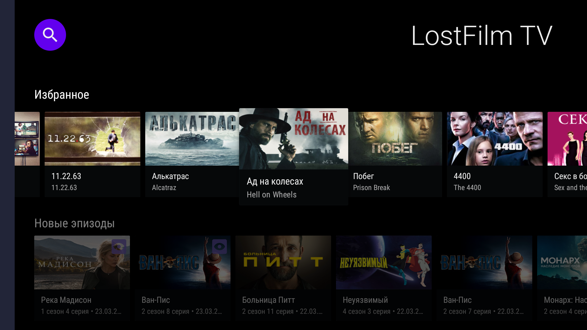
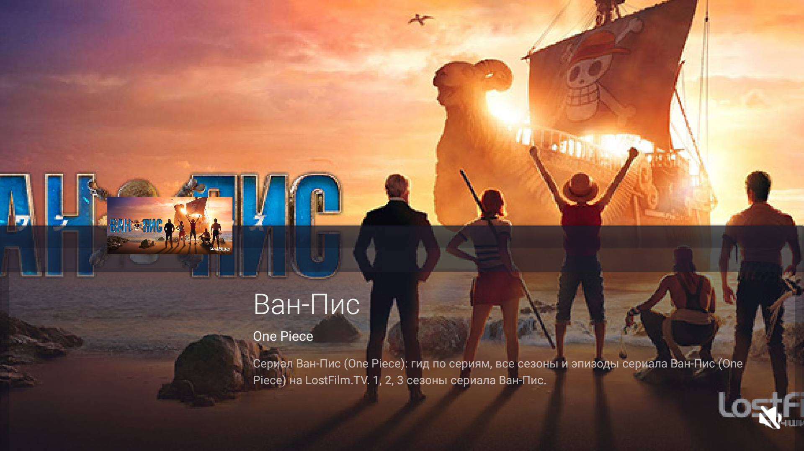
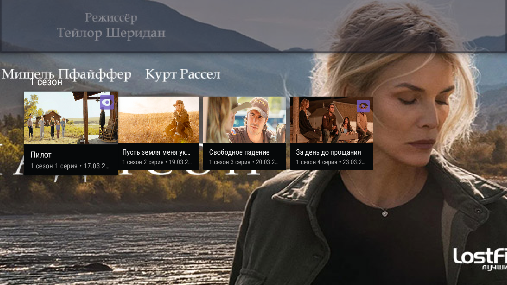
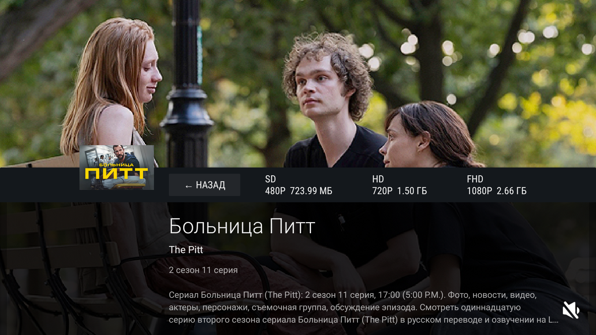
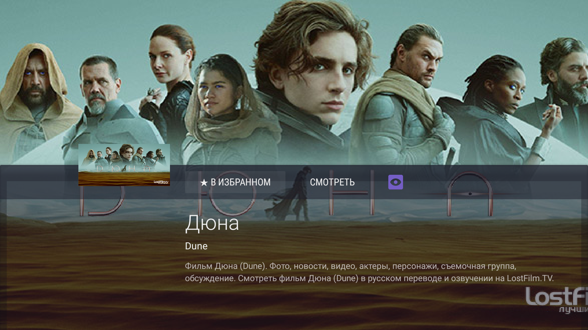
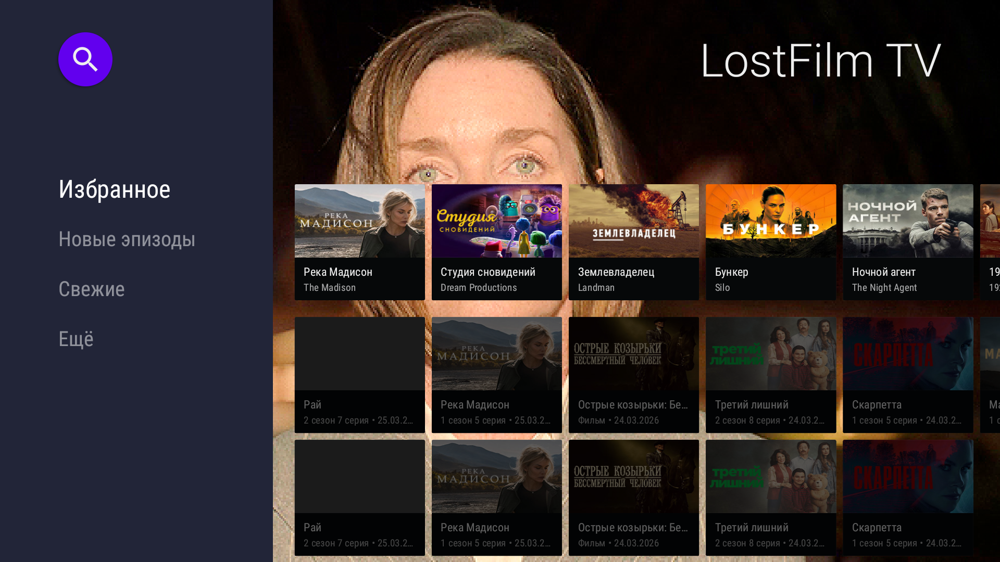

# 📺 LostFilm ATV

<p align="center">
  
</p>

**Неофициальный клиент [LostFilm.TV](https://lostfilm.tv) для Android TV.**

Продолжение проекта легендарного неизвестного разработчика, который вёл это приложение более 5 лет на канале [@lostfilmatv](https://t.me/lostfilmatv).

---

## ✨ Возможности

- 🔍 **Поиск** сериалов и фильмов по каталогу LostFilm
- ⭐ **Избранное** — добавляйте сериалы и фильмы в список отслеживания
- 📺 **Новые эпизоды** — лента последних вышедших серий
- 👁 **Статус просмотра** — отметки «просмотрено» синхронизируются с сайтом
- 🎬 **Фильмы** — полная поддержка фильмов из каталога LostFilm
- 🔒 **Обход DPI** — встроенный ciadpi-прокси с автоматическим подбором стратегии
- 📡 **UDP Broadcast** — отправка .torrent в локальную сеть (для Transmission и др.)
- 🎯 **Leanback UI** — нативный интерфейс для пульта ДУ

---

## 📱 Скриншоты

<table>
  <tr>
    <td><br/><b>Главный экран</b></td>
    <td><br/><b>Детали сериала</b></td>
  </tr>
  <tr>
    <td><br/><b>Сезоны и серии</b></td>
    <td><br/><b>Выбор качества торрента</b></td>
  </tr>
  <tr>
    <td><br/><b>Страница фильма</b></td>
    <td><br/><b>Авторизация</b></td>
  </tr>
</table>

---

## 🚀 Установка

### Готовый APK

Скачайте последний релиз из [Releases](../../releases):

| APK | Архитектура | Устройства |
|-----|-------------|------------|
| `app-arm64-v8a-release.apk` | ARM 64-bit | Большинство современных ТВ-приставок |
| `app-armeabi-v7a-release.apk` | ARM 32-bit | Старые устройства |
| `app-universal-release.apk` | Все | Универсальный (чуть больше размер) |

```bash
adb install app-universal-release.apk
```

### Сборка из исходников

```bash
git clone https://github.com/toxeh/LostFilm.git
cd LostFilm/LostFilmApp

# Debug APK
./gradle-8.7/bin/gradle assembleDebug

# Release APKs (arm64 + armv7 + universal)
./gradle-8.7/bin/gradle assembleRelease
```

APK появятся в `app/build/outputs/apk/`.

---

## ⚙️ Настройки

Доступны из главного экрана:

- **Обход DPI** — автоматический подбор стратегии при первом запуске (TLS record split, TTL fake и др.)
- **UDP Broadcast торрентов** — отправка `.torrent` файлов по UDP broadcast в локальную сеть
- **Порт broadcast** — настраиваемый (по умолчанию `41000`)
- **Очистка кэша** картинок
- **Выход из аккаунта**

### 📡 UDP Broadcast → Transmission

При включённом broadcast, каждый скачанный `.torrent` отправляется на `255.255.255.255:41000`. На стороне NAS/сервера запустите приёмник:

```bash
python3 torrent-receiver/torrent_receiver.py --port 41000 --watch-dir /path/to/transmission/watch
```

Transmission подхватит файлы автоматически через `watch-dir`.

---

## 🏗 Технологии

- **Kotlin** + **Leanback** (AndroidX TV)
- **OkHttp** + **Jsoup** — сетевой слой и парсинг HTML
- **Coil** — загрузка изображений
- **ciadpi** — обход DPI блокировок (static-pie binary)

### Архитектура

```
LostFilmApp/
├── network/
│   ├── LostFilmRepository.kt   # Парсинг сайта, API, торренты
│   ├── LostFilmAuth.kt         # Авторизация + cookies
│   ├── CiadpiRunner.kt         # Запуск ciadpi прокси
│   ├── CiadpiTuner.kt          # Автоподбор стратегии DPI
│   └── NetworkClient.kt        # OkHttp клиент
├── ui/
│   ├── MainBrowseFragment.kt   # Главный экран (Leanback BrowseFragment)
│   ├── SerieDetailsFragment.kt # Детали сериала/фильма
│   ├── EpisodeDetailsFragment.kt # Детали серии + торренты
│   ├── EpisodeCardPresenter.kt # Карточки эпизодов
│   ├── LoginFragment.kt        # Авторизация
│   ├── SearchFragment.kt       # Поиск
│   └── SettingsFragment.kt     # Настройки
└── jniLibs/
    ├── arm64-v8a/libciadpi.so
    └── armeabi-v7a/libciadpi.so
```

---

## 📋 Требования

- Android TV / Android 7.0+ (API 24)
- Аккаунт на [lostfilm.tv](https://lostfilm.tv)
- TorrServer, LibreTorrent или другой торрент-клиент на устройстве

---

## 🙏 Благодарности

- Оригинальному разработчику LostFilm ATV — [@lostfilmatv](https://t.me/lostfilmatv)
- [LostFilm.TV](https://lostfilm.tv) — за лучшие переводы сериалов
- [ciadpi](https://github.com/hufrea/byedpi) — обход DPI блокировок

---

## ⚠️ Отказ от ответственности

Данное приложение является **неофициальным клиентом** и не связано с LostFilm.TV. Весь контент принадлежит правообладателям. Приложение лишь предоставляет удобный интерфейс для доступа к сайту lostfilm.tv через Android TV.

---

## 📬 Контакты

Telegram: [@lostfilmatv](https://t.me/lostfilmatv)
